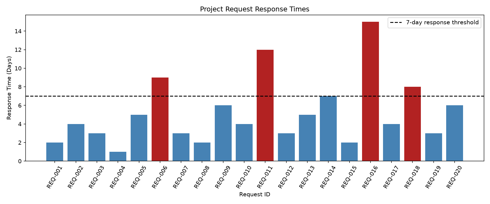

# cintel-02-project-anomalies

[](pyproject.toml)
[](https://github.com/bcookson85/cintel-02-project-anomalies/actions/workflows/ci-python-zensical.yml)
[](https://bcookson85.github.io/cintel-02-project-anomalies/)
[](https://docs.astral.sh/uv/)
[](https://docs.astral.sh/ty/)
[](https://zensical.org/)
[](LICENSE)

> Exploring static anomaly detection using Python, with a focus on identifying unusual project response times and operational delays.

## Project Overview

Author: Brian Cookson

Date: 2026 October


This project applies static anomaly detection techniques to project performance monitoring as part of the Continuous Intelligence course at Northwest Missouri State University.

The application analyzes a synthetic dataset of 20 project requests across Planning, Design, and Construction phases. Using Python and Polars, it identifies requests with response times exceeding a predefined seven-day threshold.

The completed analysis identified four requests requiring additional review, representing 20% of the dataset. A Matplotlib visualization highlights these observations and provides a clear comparison against the selected threshold.

The project builds upon Dr. Denise Case's original pediatric clinic anomaly detection example, adapting the analytical techniques to a project management problem while preserving the original application for reference.

Project dependencies and configuration are maintained in [pyproject.toml](pyproject.toml).


## Data

The custom application uses a synthetic dataset of 20 fictional project requests stored in [data/project_responses.csv](data/project_responses.csv).

Each observation includes:

- `request_id` - Unique identifier for the request.
- `project_phase` - Planning, Design, or Construction.
- `response_days` - Number of days required to receive a response.

The dataset was created for educational purposes and contains no actual employer or client information.

The original clinic dataset remains available in `data/clinic_data.csv` as part of the adapted example.

## Approach

The custom project uses Python and Polars to load a synthetic
dataset of project requests, apply a seven-day response-time
threshold, and save observations requiring further review.

Requests with response times greater than seven days are
flagged as anomalies.

The application also uses Matplotlib to visualize the
response times and highlight the flagged requests.

### Project Components

- [pyproject.toml](pyproject.toml) - Project configuration and dependencies.
- [project_monitor.py](src/cintel/project_monitor.py) - Main custom anomaly detection pipeline.
- [utils_project.py](src/cintel/utils_project.py) - Reusable data-loading and detection functions.
- [visualize_project.py](src/cintel/visualize_project.py) - Generates the response-time chart.
- [data/](data/) - Original and custom input datasets.
- [artifacts/](artifacts/) - Generated anomaly detection results.
- [tests/](tests/) - Automated Python tests.
- [.github/workflows/](.github/workflows/) - Automated checks and documentation deployment.
- [docs/](docs/) - Published project documentation.

The original clinic example remains available in
`src/cintel/anomaly_detector.py` for comparison.

## Run the Project

The project uses Python 3.14 and uv for dependency management.

### Set Up the Environment

Clone the repository, open it in VS Code,
and run the following commands from the project root:

```powershell
uv python install
uv sync
```

### Run the Custom Anomaly Detection Pipeline

```powershell
uv run python -m cintel.project_monitor
```

This command loads 20 synthetic project requests,
applies a seven-day response-time threshold,
and saves flagged records to:

`artifacts/project_anomalies.csv`

### Generate the Results Visualization

```powershell
uv run python -m cintel.visualize_project
```

This generates the visualization at:

`docs/images/project_response_chart.png`

### Run the Original Example

The original clinic anomaly detection pipeline
can still be executed using:

```powershell
uv run python -m cintel.anomaly_detector
```

## Run the Original Clinic Reactive App

From a VS Code terminal in the project root
(hit CTRL + c to quit):

```shell
uv run marimo run  src/cintel/app.py
```

## Results

The custom Project Performance Monitoring pipeline successfully
analyzed 20 synthetic project requests using a seven-day
response-time threshold.

Four requests exceeded the selected threshold, representing
20% of the dataset.

The flagged requests are saved in
[artifacts/project_anomalies.csv](artifacts/project_anomalies.csv).

The results are also presented in the
[Project Performance Monitoring Report](docs/index.md),
including a visualization, interpretation, and limitations.

The original clinic example and the earlier threshold
experiment are preserved for comparison.

### Technical Experiment: Height Threshold Adjustment

**Objective:** Evaluate how changing a static anomaly detection threshold affects the number of flagged observations.

**Original configuration:**
- Age threshold: 16 years
- Height threshold: 72 inches
- Records analyzed: 22
- Anomalies detected: 3

**Modification:**
- Reduced the height threshold from 72 inches to 68 inches.
- Kept the age threshold unchanged at 16 years.

**Prediction:** Lowering the height threshold would increase or maintain the number of detected anomalies.

**Observed results:** The modified pipeline identified 4 anomalies, compared with 3 in the original configuration.

**Interpretation:** Lowering the height threshold increased the number of records flagged for review by one. This experiment demonstrates how threshold selection affects anomaly detection sensitivity.

**Limitation:** A flagged observation is not necessarily an error. Additional context would be required to determine whether each flagged record represents a meaningful anomaly.

## Verification

Run the automated tests:

```shell
uv run pytest
```


## Custom Application: Project Performance Monitoring

This project extends the original static anomaly detection example to analyze project request response times.

The custom application uses a synthetic dataset of 20 project requests representing Planning, Design, and Construction activities.

### Business Problem

Delayed responses to project requests can create operational bottlenecks and affect project performance.

The objective is to identify requests with unusually long response times so they can be prioritized for further review.

### Detection Method

The application uses rule-based static anomaly detection.

Requests with response times greater than seven days are flagged as anomalies.

The seven-day threshold is an instructional assumption rather than an established organizational standard.

### Custom Project Commands

Run the anomaly detection pipeline:

```powershell
uv run python -m cintel.project_monitor
```

Generate the results visualization:

```powershell
uv run python -m cintel.visualize_project
```

### Verified Results

The application successfully analyzed 20 project requests and identified four anomalies.

- Total requests: 20
- Flagged requests: 4
- Anomaly rate: 20%
- Longest response time: 15 days
- Output: `artifacts/project_anomalies.csv`

### Results Visualization



*Figure 1. Four project requests exceeded the selected seven-day response-time threshold.*

### Project Files

- [Project Dataset](data/project_responses.csv)
- [Custom Detection Pipeline](src/cintel/project_monitor.py)
- [Reusable Detection Functions](src/cintel/utils_project.py)
- [Visualization Script](src/cintel/visualize_project.py)
- [Anomaly Results](artifacts/project_anomalies.csv)
- [Full Project Report](docs/index.md)

The original clinic anomaly detection application remains available as a reference.

## Project Documentation

The [hosted documentation site](https://bcookson85.github.io/cintel-02-project-anomalies/)
is published using Zensical and GitHub Pages.

The documentation site is used to present the project report,
covering such sections as data, methods, results, visualizations,
interpretation, and conclusions.

## CI/CD and GitHub Actions

This project includes continuous integration and continuous deployment (CI/CD)
to check project files and publish the docs.
GitHub Actions include:

- [CI: Python and Documentation Checks](https://github.com/bcookson85/cintel-02-project-anomalies/actions/workflows/ci-python-zensical.yml)
- [CD: Documentation Deployment](https://github.com/bcookson85/cintel-02-project-anomalies/actions/workflows/deploy-zensical.yml)

## Developer Reference

Follow the
[Professional Python Workflow Guide](https://denisecase.github.io/pro-analytics-02/)
for **detailed instructions and troubleshooting**.

### Initialize and Update the Python Environment

With the project open in VS Code, open a VS Code terminal.
Paste each command and hit Enter or Return after to run it.

```shell
uvx pup-clean --delete
uv self update
uv python pin 3.14
uv python install
uv lock --upgrade
uv sync
uv audit
```

### Set Up and Run Git Hooks

Set up and run the git hooks to perform
basic checks automatically before
any changes get pushed to GitHub.

In the VS Code terminal,
paste each command and hit Enter or Return after to run it.

```shell
uvx prek install --force
uvx prek update --freeze --cooldown-days 7

git add -A
uvx prek run --all-files
# repeat if changes were made
uvx prek run --all-files
```

### Run Common Chores

Run linters, formatters, type checks, tests, and
build the documentation.

```shell
uv run ruff check . --fix
uv run ruff format .

uv run ty check
uv run python -m pytest
uv run python -m zensical build
```

### Git add-commit-push to GitHub

After making useful changes, save your work to GitHub.

```shell
git add -A
git commit -m "describe your changes in quotes"
git push -u origin main
```

## Developer Notes

- Use the **UP ARROW** and **DOWN ARROW** in the terminal to scroll through past commands.
- Use `CTRL+f` to find (and replace) text within a file.

## Developer Tools

This project uses professional Python tools to support development,
testing, documentation, and code quality.

- [uv](https://docs.astral.sh/uv/) - Python environments and dependencies.
- [Ruff](https://docs.astral.sh/ruff/) - Python linting and formatting, configured in [.ruff.toml](.ruff.toml).
- [ty](https://docs.astral.sh/ty/) - Python type checking.
- [pytest](https://docs.pytest.org/) - automated Python testing, configured in [.pytest.toml](.pytest.toml).
- [prek](https://prek.j178.dev/) - Git hooks and automated checks, configured in [prek.toml](prek.toml).
- [Zensical](https://zensical.org/) - project documentation, configured in [zensical.toml](zensical.toml).

## Links

- [Project Documentation](https://bcookson85.github.io/cintel-02-project-anomalies/)
- [GitHub Repository](https://github.com/bcookson85/cintel-02-project-anomalies)
- [Original Example Project](https://github.com/denisecase/cintel-02-static-anomalies)
- **Data Source:** The original example clinic dataset included in the project's `data/` folder.
- [Professional Python Workflow Guide](https://denisecase.github.io/pro-analytics-02/)
- [Citation](CITATION.cff)
- [License](LICENSE)
